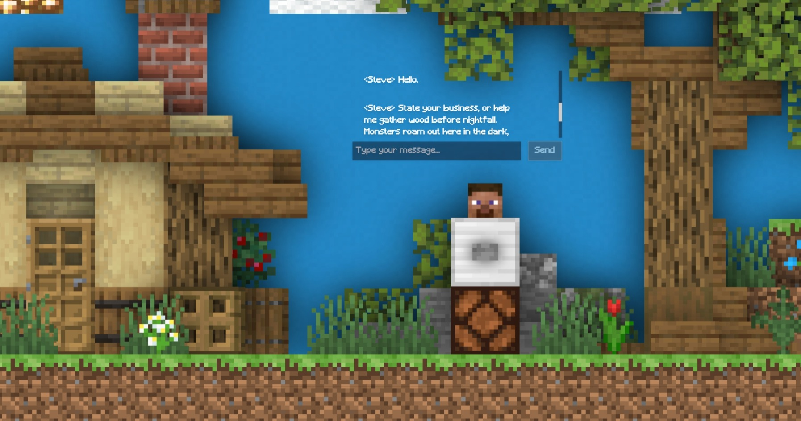

# Gemini Minecraft Chatbot

An interactive Minecraft-themed chatbot powered by Google Gemini. Talk with Steve, your knowledgeable yet existentially aware Minecraft guide, set against an immersive multi-layer parallax backdrop.



---

## ✨ Features

- **Minecraft-Themed Steve AI**: Steve shares tips, crafting advice, and game knowledge in character—serious, adventurous, and occasionally questioning his own simulated existence.
- **Dynamic Multi-Layer Parallax**: 
  - Smooth mouse-tracking on desktop.
  - High-sensitivity touch & drag support on mobile devices.
  - Subtle floating ambient idle animation.
- **Stop Generation Support**: A responsive Stop button replacing Send whenever Gemini is thinking or typing, allowing instant cancellation.
- **Typewriter Effect**: Authentic dialogue pacing with randomized pauses and Minecraft-styled chat bubbles.
- **Sound & Ambience**: In-game stone button click sounds and Minecraft background soundtrack.
- **Responsive Design**: Tailored layouts for desktop, tablets, and mobile devices with Tailwind CSS.

---

## 🛠️ Tech Stack

- **Frontend**: HTML5, CSS3, Vanilla JavaScript (Browser ES Modules)
- **Tooling & Build**: Node.js & npm (Tailwind CSS CLI compiler)
- **Backend**: Node.js (Vercel Serverless Function `api/chat.js`)
- **AI Model**: Google Gemini API (`gemini-1.5-flash` / configurable via environment variable)

---

## 🚀 Getting Started

### Prerequisites

- [Node.js](https://nodejs.org/) installed (for npm and Tailwind CSS build tooling).
- A [Google AI Studio](https://aistudio.google.com/) account to get a Gemini API key.

### Local Setup

1. **Clone the repository**:
   ```bash
   git clone https://github.com/your-username/Gemini-Minecraft-Chatbot.git
   cd Gemini-Minecraft-Chatbot
   ```

2. **Install dependencies**:
   ```bash
   npm install
   ```

3. **(Optional) Build Tailwind CSS**:
   ```bash
   npm run build
   ```

4. **Set up Environment Variables**:
   Create a `.env` file or configure your environment variables:
   ```env
   GEMINI_API_KEY=your_gemini_api_key_here
   GEMINI_MODEL=gemini-1.5-flash
   ```

5. **Run with Vercel CLI**:
   ```bash
   npx vercel dev
   ```
   Open [http://localhost:3000](http://localhost:3000) in your browser.

---

## ☁️ Deployment (Vercel)

1. Import this repository into **Vercel** with the root directory set to the project root.
2. Select framework preset as **Other** (no build command needed).
3. In the project settings under **Environment Variables**, add:
   - `GEMINI_API_KEY`: Your Google Gemini API key.
   - `GEMINI_MODEL` *(optional)*: Defaults to `gemini-1.5-flash`.
4. Deploy the project!

---

## 👤 Author

- **Cj Vhert M. Rojo**

